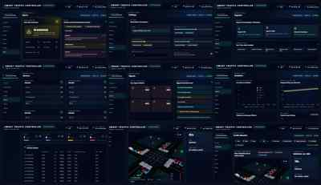

# Real-Time Smart Traffic Controller



Professional React/Vite dashboard prototype for a ROS2 smart traffic light control project.

## Features

- Dark smart-city control center interface
- Animated 2D four-way intersection simulation
- North/South, East/West, yellow transition, and all-red clearance phase states
- Real-time simulated queue counters, latency, jitter, CPU, RAM, and clock updates
- Safety Monitor with conflict and fault counters
- Recharts telemetry panels for traffic queues, latency, CPU by node, and health donut
- Phase timeline in a Gantt-style layout
- Reusable React components for presentation-friendly code structure

## Tech Stack

React, Vite, Tailwind CSS, Recharts, Lucide React, and Three.js.

## Run Locally

```bash
npm install
npm run dev
```

Open the local Vite URL shown in the terminal, usually `http://localhost:5173`.

## Production Build

```bash
npm run build
```
